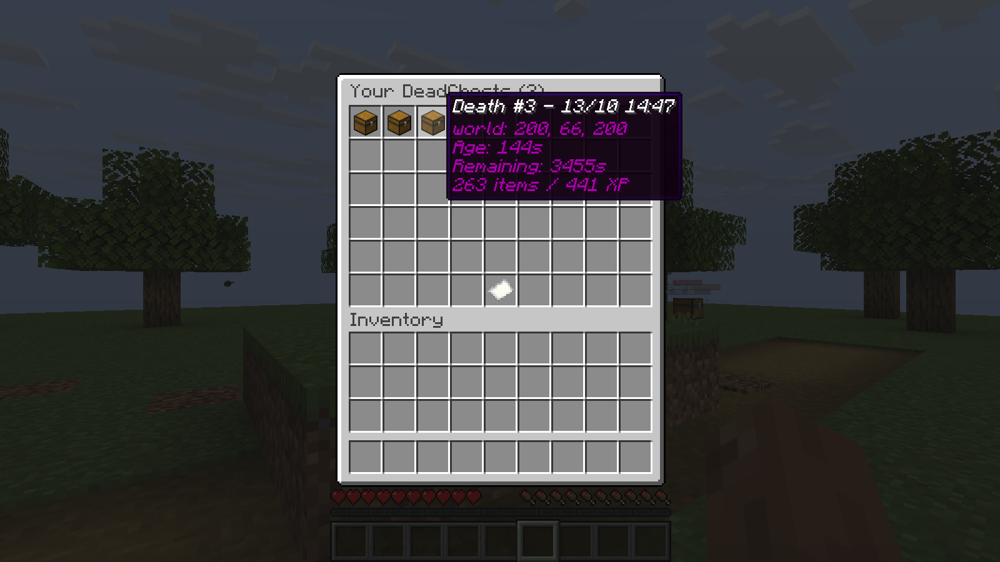
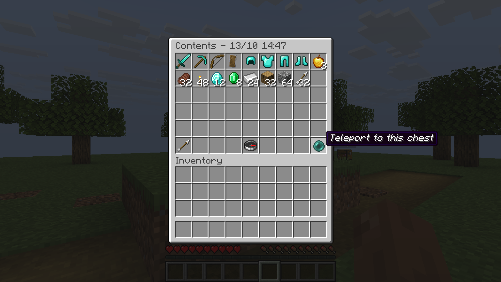
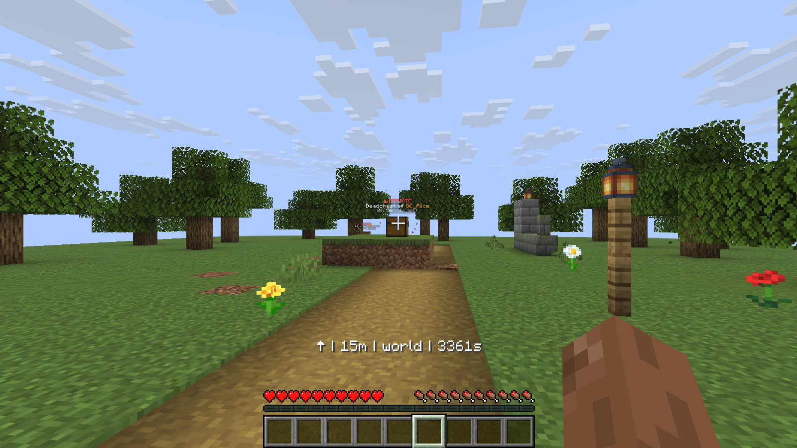

# Chest menu and tracking

## Chest menu

Run `/dc menu` in game. The menu lists your active chests, newest first, with
pages when needed. Entries show a readable death number and date, location,
remaining time, item count and XP.

Select a chest to preview its contents without removing anything. The interface
also offers tracking and teleportation, subject to their permissions and settings.
Right-click previews of a chest in the world respect the core access rules,
including private/public access and the recovery permission when required.

Opening a preview does not collect items or pause the expiration timer.
Normal collection still happens at the chest. With inventory recovery enabled,
one click takes what fits and leaves the remainder for another click.

Permission: `deadchest.pro.menu`, granted to everyone by default.

{ loading=lazy }

*Hover over an entry to see its details before selecting it.*

{ loading=lazy }

*Inspect the stored items and use the controls below them. Teleportation requires its own permission and must be enabled.*

## Live tracking

```text
/dc track
/dc track 2
/dc track off
```

Without an argument, tracking selects your latest chest. The live display shows
direction, distance and remaining time. For a chest in another world, it tells
you which world to visit. `/dc track off` stops the guidance.

Permission: `deadchest.pro.track`, granted to everyone by default.

{ loading=lazy }

*Follow the direction arrow while checking distance and expiry without opening a menu.*

## Selecting a chest

Both `/dc track` and `/dc teleport` accept `latest`, a number from the current
menu order, or a full chest UUID. `1` is the newest chest. Numbers can change
when chests are created or collected; they are not permanent identifiers.

Menu buttons remain linked to the specific chest displayed. Players can use
the menus and numbered commands without copying UUIDs.
