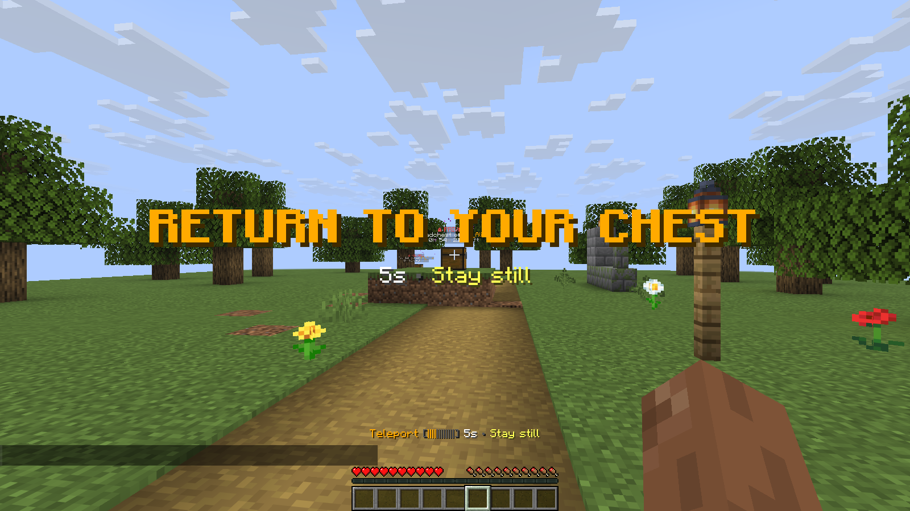

# Teleportation

Teleportation returns a player near their chest after a countdown. It is
**disabled by default** and requires `deadchest.pro.teleport`.

## Enable teleportation

In `plugins/Deadchest-Pro/pro.yml`:

```yaml
teleport:
  enabled: true
  warmup-seconds: 5
  cooldown-seconds: 300
  cross-world: false
  denied-worlds: []
  feedback:
    action-bar: true
    titles: true
    particles: true
    sounds: true
```

Grant `deadchest.pro.teleport` to the desired players or groups using your
permission manager, then run `/dc reload`. Operators have this permission by
default, but the feature must still be enabled in the configuration.

Players can use `/dc teleport`, `/dc teleport 2`, or the button in a chest preview.
Selection follows the same rules as [tracking](player-tools.md#selecting-a-chest).

{ loading=lazy }

*The countdown tells the player to stay still until teleportation completes. This demonstration uses custom timing; the defaults are listed below.*

## Countdown and cooldown

The default warmup lasts five seconds. Movement, damage, death, disconnection,
another teleport or a configuration reload can cancel a pending teleport.
Repeating the command during the countdown does not restart it.

The 300-second cooldown starts only after a successful teleport. Failed or
cancelled attempts do not start it. A value of `0` disables the corresponding delay.

The action bar, countdown and arrival titles, particles and sounds can be
disabled separately. Teleport feedback takes priority over tracking while active.

## Worlds and safe destinations

Cross-world travel is disabled by default. Set `cross-world: true` to allow it.
`denied-worlds` uses exact world names and applies to both departure and destination.

The plugin checks nearby footing, space for the player, hazards and the world
border before teleporting. It searches within the chest's chunk, up to four
blocks horizontally and from three blocks below to four above the chest.
A chest near a chunk boundary can have no acceptable destination in that area.

## When a teleport is refused

Messages distinguish disabled teleportation, missing permission, cooldown,
blocked or unavailable worlds, disabled cross-world travel, unavailable chests,
access restrictions, dead players, vehicles and a lack of safe footing.

Check the reported reason first. If the destination is unsafe, approach normally
or make the nearby area safe. Another plugin or the server can also reject the
teleport; its exact reason may not be available to DeadChest.
